<div align="center">

# ⚔️ CodeArena

**Un juge en ligne pour les concours de programmation.**
Écrivez du code dans le navigateur : il est compilé et exécuté dans un bac à sable verrouillé, et chaque test passe au vert en direct.

[](https://github.com/Zakariae4AL/CodeArena/actions/workflows/ci.yml)


[🇬🇧 English](README.md) · 🇫🇷 Français

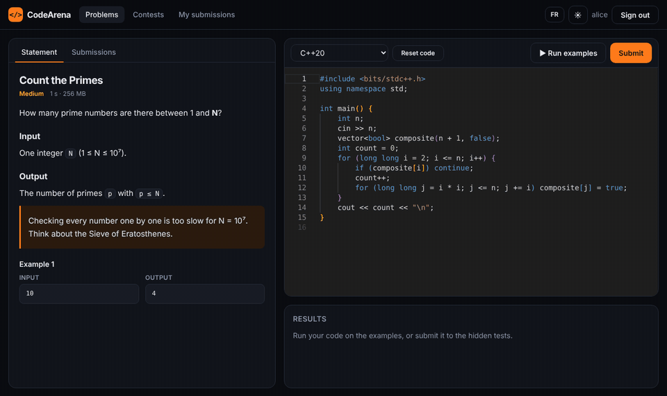

</div>

## Sommaire

- [Ce que fait l’application](#ce-que-fait-lapplication)
- [Captures d’écran](#captures-décran)
- [Architecture](#architecture)
- [Comment une soumission est jugée](#comment-une-soumission-est-jugée)
- [Le bac à sable](#le-bac-à-sable)
- [Technologies](#technologies)
- [Démarrage](#démarrage)
- [Configuration](#configuration)
- [API](#api)
- [Tests](#tests)
- [Structure du projet](#structure-du-projet)
- [Feuille de route](#feuille-de-route)

## Ce que fait l’application

- 🧑‍💻 **Résoudre des problèmes** en **C++20, Java 25, Python 3 ou JavaScript** dans l’éditeur Monaco (celui de VS Code). Les brouillons sont sauvegardés par problème et par langage.
- ▶️ **Tester** son code sur les exemples pour comparer sa sortie à la sortie attendue, puis le **soumettre** aux tests cachés.
- ⚡ **Verdicts en direct** : chaque résultat de test arrive par WebSocket dès qu’il est jugé — *Accepté*, *Mauvaise réponse*, *Temps / Mémoire / Sortie dépassés*, *Erreur d’exécution*, *Erreur de compilation*.
- 🏆 **Concours** avec compte à rebours, problèmes secrets jusqu’au départ et **classement ICPC en direct** (problèmes résolus, puis pénalité, premières résolutions mises en avant).
- 🛠️ **Administration** : éditeur de problèmes (énoncé en Markdown, limites, tests d’exemple et cachés, brouillons) et éditeur de concours.
- 🌍 Anglais / français, 🌗 thème sombre / clair, 📱 responsive, ♿ utilisable au clavier.

## Captures d’écran

| Accepté, test par test | Trop lent : temps dépassé |
| :---: | :---: |
| 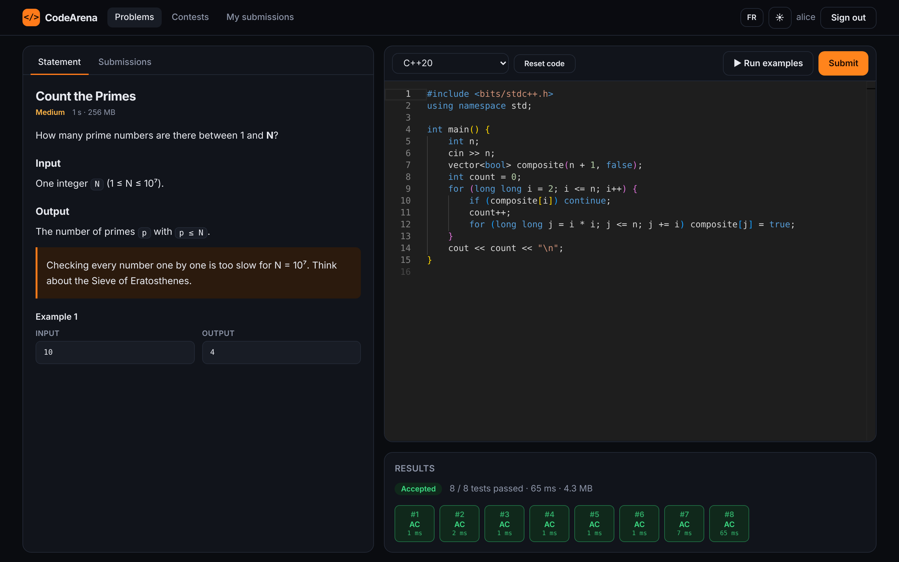 | 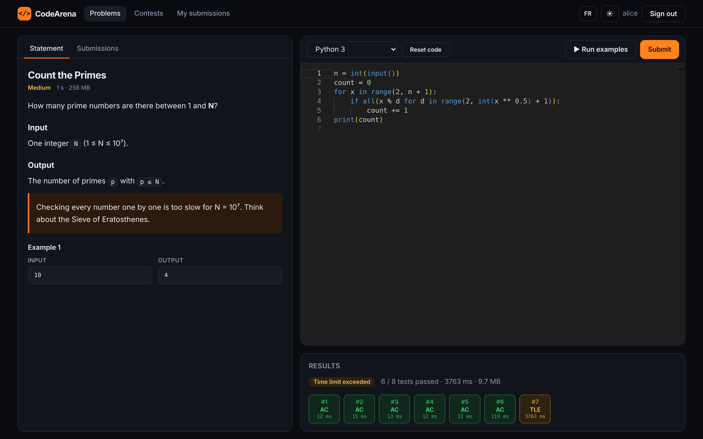 |
| **Test sur les exemples : votre sortie vs l’attendue** | **Classement ICPC en direct** |
| 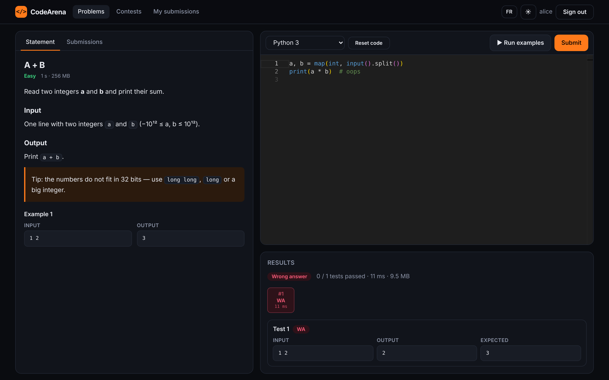 | 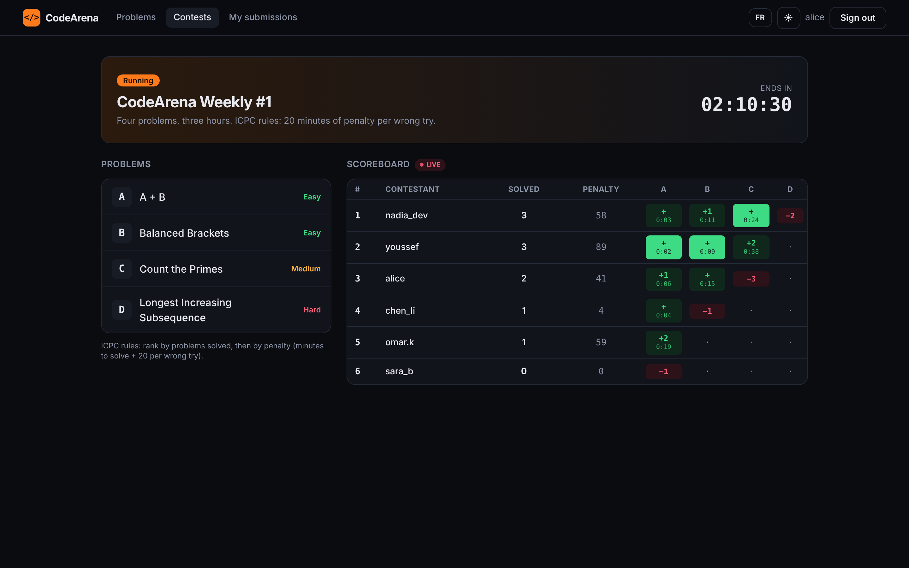 |
| **Thème clair, en français** | **Liste des concours, en français** |
| 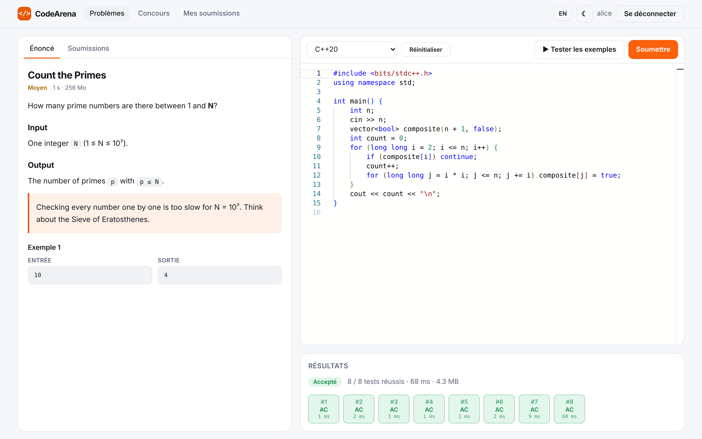 | 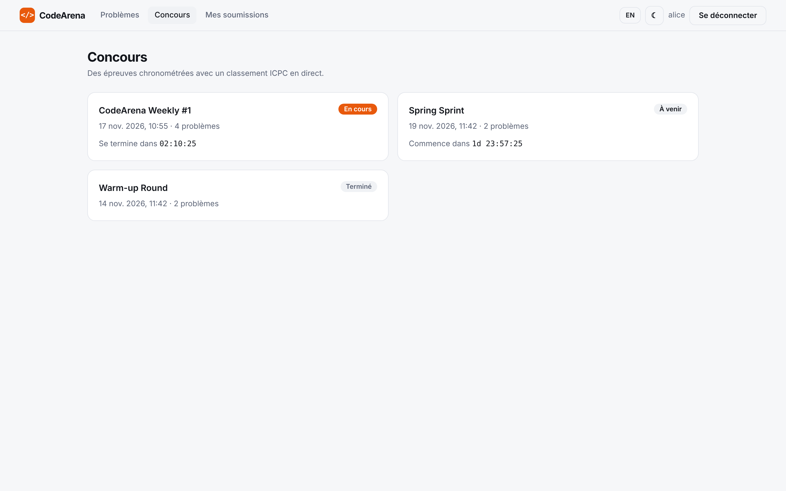 |
| **Problèmes** | **Éditeur de problèmes (admin)** |
| 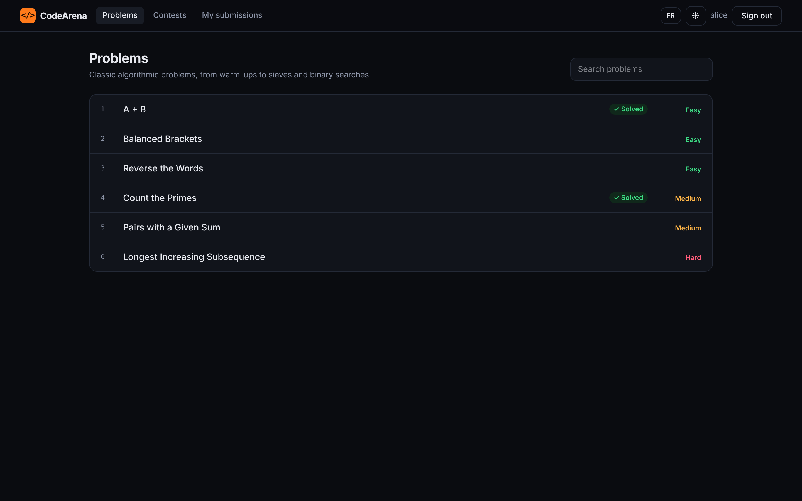 | 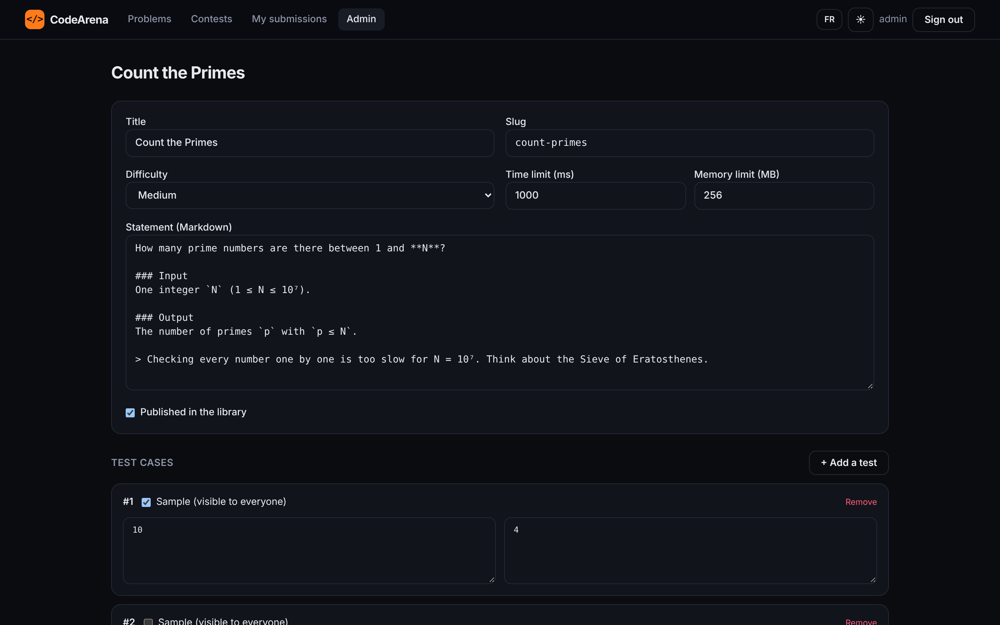 |

<p align="center">
  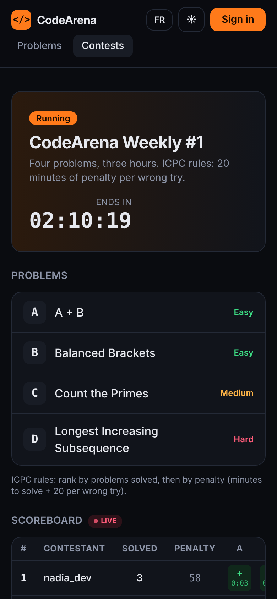
  &nbsp;
  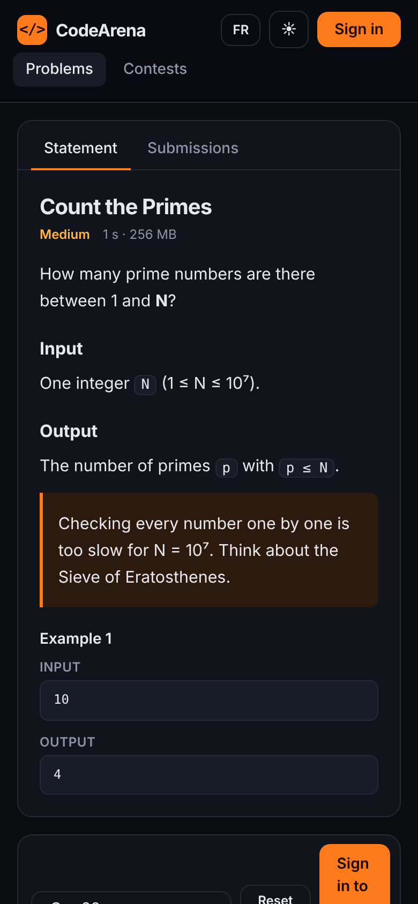
</p>

> Tous les verdicts de ces captures sont réels : le code a été compilé et exécuté par le juge Go dans des bacs à sable Docker.

## Architecture

Trois programmes, chacun dans le langage adapté à son rôle :

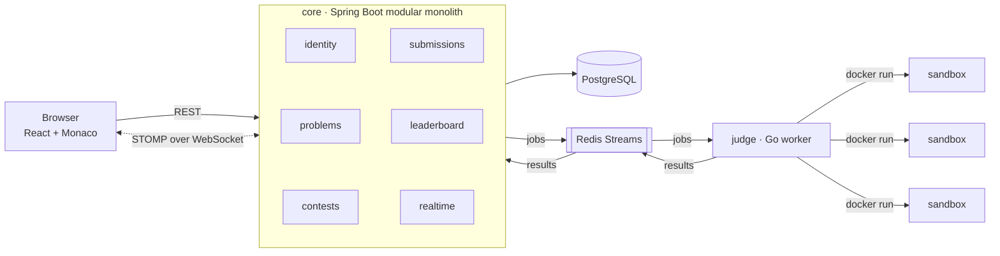

| Partie | Langage | Pourquoi |
| --- | --- | --- |
| **core** | Java 21 · Spring Boot 4 · **Spring Modulith** | Règles métier, sécurité, persistance, temps réel. Un seul déploiement, découpé en modules aux frontières vérifiées. |
| **judge** | **Go 1.26**, bibliothèque standard uniquement | Exécute du code non fiable : binaires statiques, contrôle précis des processus (groupes, rusage, signaux), aucune dépendance tierce dans un composant critique. |
| **web** | React 19 · TypeScript 7 · Vite | Éditeur Monaco, mises à jour en direct, i18n. |

### Un monolithe modulaire

Le core est **une seule application Spring Boot découpée en six modules**. [Spring Modulith](https://spring.io/projects/spring-modulith) **fait échouer le build** (`ModularityTests`) si un module touche aux classes internes d’un autre ou si des modules dépendent les uns des autres en boucle.

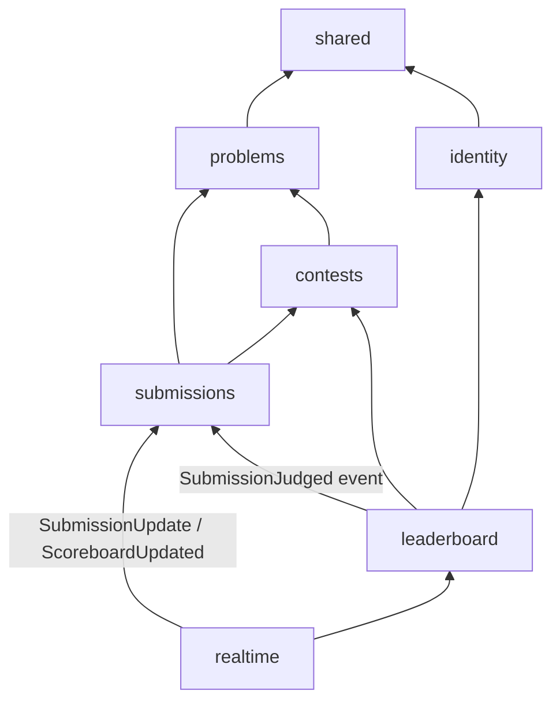

- Chaque module expose une petite **API publique** (`ProblemCatalog`, `ContestDirectory`, `UserDirectory`…) ; le reste vit dans un package `internal`.
- Les modules ne partagent aucune table et se référencent **uniquement par identifiant**, sans clé étrangère entre modules : un module pourrait devenir un service séparé.
- Les modules communiquent par **événements**. `SubmissionJudged` est enregistré dans le **registre de publication d’événements** dans la même transaction que le verdict (outbox transactionnelle) : si le classement échoue, l’événement est rejoué, jamais perdu. L’envoi des jobs vers Redis fonctionne de la même façon.
- Le build génère aussi des **diagrammes C4 / UML** des modules (`target/spring-modulith-docs`, publiés par la CI).

## Comment une soumission est jugée

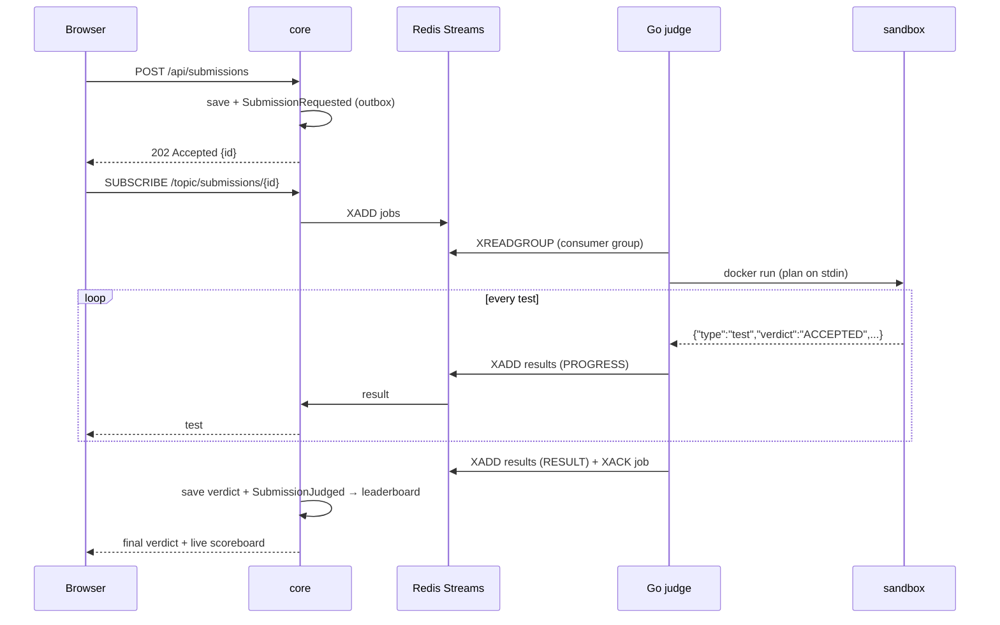

- **File fiable** : les juges se partagent les jobs via un **groupe de consommateurs** ; un job n’est acquitté qu’après la publication de ses résultats. Si un juge plante, un autre **récupère** ses jobs en attente (`XAUTOCLAIM`) ; un job qui échoue 3 fois est abandonné et signalé comme *Erreur système*.
- **Passe à l’échelle** : lancez plus de conteneurs `judge` pour juger plus de soumissions en parallèle.
- **Idempotent** : un résultat reçu deux fois est ignoré.
- **Tester** n’utilise que les exemples et affiche la sortie ; **Soumettre** lance tous les tests et s’arrête au premier échec, comme sur Codeforces.

## Le bac à sable

Chaque soumission tourne dans un **nouveau conteneur jetable**. À l’intérieur, un petit programme Go, `boxrun`, compile le code et exécute les tests.

| Menace | Protection |
| --- | --- |
| Accéder au réseau | `--network none` |
| Modifier le système | Système de fichiers en **lecture seule** ; seul un `tmpfs` de 64 Mo est inscriptible |
| S’exécuter en root | Le programme tourne en **`nobody`** (uid 65534) ; `boxrun` ne garde que `SETUID`, `SETGID` et `KILL` ; `--cap-drop ALL`, `no-new-privileges` |
| **Lire les réponses attendues** | Les sorties cachées ne touchent jamais le disque : elles arrivent à `boxrun` sur l’entrée standard et restent dans sa mémoire (processus d’un autre utilisateur) |
| Fork bomb | `--pids-limit 128`, puis `boxrun` (PID 1) tue **tous** les processus du conteneur jusqu’au dernier |
| Mémoire | Limite cgroup + contrôle du RSS par test, ou la limite du runtime (JVM `-Xmx`, V8 `--max-old-space-size`) |
| Boucle infinie / attente | Limite de temps CPU et arrêt au bout d’un temps réel (tout le groupe de processus) |
| Sortie infinie | Sortie plafonnée et programme tué → *Sortie trop longue* |
| Fichiers énormes, core dumps, trop de fichiers | `ulimit` sur la taille des fichiers, des core dumps et le nombre de fichiers ouverts |
| Sortir du conteneur | Runtime **gVisor** optionnel : `JUDGE_DOCKER_RUNTIME=runsc` |

Les runtimes plus lents ont une limite de temps équitable : ×2 pour Java, ×3 pour Python, ×1,5 pour JavaScript.

Ces protections sont **testées sur de vrais conteneurs dans la CI** (`TestRealSandbox`) : pas de réseau, racine en lecture seule, pas root, fork bomb contenue, limite mémoire atteinte.

> ⚠️ Le juge contrôle le moteur Docker (`/var/run/docker.sock`). En production, faites tourner les juges sur des machines dédiées, idéalement avec gVisor.

## Technologies

| Domaine | Technologies |
| --- | --- |
| Core | Java 21, Spring Boot 4.1, **Spring Modulith 2.1** (vérification des modules, registre d’événements, documentation), Spring Security (JWT), Spring Data JPA, Flyway, Spring WebSocket (STOMP), Spring Data Redis, Bean Validation, Actuator |
| Juge | Go 1.26 (bibliothèque standard uniquement : client RESP maison pour Redis Streams), Docker |
| Web | React 19, TypeScript 7, Vite 8, Tailwind CSS 4, TanStack Query, React Router, Monaco Editor (embarqué, sans CDN), STOMP.js, react-markdown |
| Données | PostgreSQL 18, Redis 8 (Streams, groupes de consommateurs) |
| Qualité | JUnit 5, MockMvc, Awaitility · tests Go avec vrais compilateurs, Redis et Docker · Vitest, Testing Library · Prettier, oxlint, gofmt · GitHub Actions |
| Livraison | Docker Compose, images multi-étapes, nginx |

## Démarrage

### Avec Docker (recommandé)

Prérequis : **Docker Desktop** (Windows/macOS, avec WSL 2 sous Windows) ou Docker Engine sous Linux.

```bash
git clone https://github.com/Zakariae4AL/CodeArena.git
cd CodeArena
docker compose --profile runners build   # images des bacs à sable, une seule fois
docker compose up --build
```

Ouvrez **<http://localhost:8088>** et connectez-vous avec un compte de démo :

| Compte | Utilisateur | Mot de passe |
| --- | --- | --- |
| Administrateur | `admin` | `codearena1` |
| Participant | `alice` | `codearena1` |

La démo contient six problèmes (de *A + B* à *Longest Increasing Subsequence*, avec de gros tests générés pour que les solutions lentes dépassent le temps) et trois concours : un en cours, un à venir, un terminé.

### Pour développer

```bash
docker compose --profile runners build
docker compose up postgres redis judge -d   # ajoutez des ports à postgres et redis pour y accéder

cd core && ./mvnw spring-boot:run          # http://localhost:8080   (Windows : mvnw.cmd)
cd web  && npm install && npm run dev      # http://localhost:5173   (proxy vers /api et /ws)
```

## Configuration

| Variable | Défaut | Utilisée par | Description |
| --- | --- | --- | --- |
| `DB_URL` / `DB_USERNAME` / `DB_PASSWORD` | `codearena` local | core | Connexion PostgreSQL |
| `REDIS_HOST` / `REDIS_PORT` / `REDIS_PASSWORD` | `localhost:6379` | core | Redis |
| `JWT_SECRET` | valeur de dev | core | Clé HMAC, **≥ 32 octets** ; refusée en profil `prod` si c’est la valeur de dev |
| `CORS_ORIGINS` | `http://localhost:5173` | core | Origines autorisées (HTTP et WebSocket) |
| `SUBMISSIONS_PER_MINUTE` | `10` | core | Limite par utilisateur |
| `AUTH_RATE_LIMIT` | `10` | core | Tentatives de connexion/inscription par minute et par IP |
| `SEED_DEMO` | `true` (`false` en `prod`) | core | Comptes, problèmes et concours de démo |
| `REDIS_ADDR` / `REDIS_PASSWORD` / `REDIS_TLS` | `localhost:6379` | judge | Redis |
| `JUDGE_CONCURRENCY` | `2` | judge | Soumissions jugées en parallèle par juge |
| `JUDGE_DOCKER_RUNTIME` | – | judge | ex. `runsc` pour gVisor |
| `JUDGE_IMAGE_PREFIX` | `codearena/runner-` | judge | Noms des images des bacs à sable |
| `JUDGE_CPUS` / `JUDGE_PIDS_LIMIT` | `1` / `128` | judge | Limites du bac à sable |

## API

REST sous `/api`, erreurs au format [RFC 9457](https://www.rfc-editor.org/rfc/rfc9457), JWT dans `Authorization: Bearer …`.

| Méthode | Endpoint | Accès | Description |
| --- | --- | --- | --- |
| `POST` | `/auth/register`, `/auth/login` | Public | Renvoie un jeton (les comptes sont toujours `USER`) |
| `GET` | `/auth/me` | Connecté | Utilisateur courant |
| `GET` | `/problems`, `/problems/{slug}` | Public | Problèmes publiés ; seuls les tests d’**exemple** sont visibles |
| `GET` | `/languages` | Public | Langages disponibles |
| `POST` | `/submissions` | Connecté | `{problemId, contestSlug?, language, source, mode: RUN\|SUBMIT}` → `202` |
| `GET` | `/submissions/{id}`, `/submissions/mine`, `/submissions/solved` | Propriétaire | Verdicts, résultats par test, code |
| `GET` | `/contests`, `/contests/{slug}` | Public | Problèmes cachés jusqu’au départ |
| `GET` | `/contests/{slug}/problems/{label}` | Public après le départ | Énoncé d’un problème du concours |
| `GET` | `/contests/{slug}/scoreboard` | Public | Classement ICPC |
| `GET/POST/PUT` | `/admin/problems/**`, `/admin/contests/**` | Admin | Éditeurs (tests cachés inclus) |

**WebSocket** (`/ws`, STOMP) : abonnement à `/topic/submissions/{id}` (jugement en direct) et `/topic/contests/{id}/scoreboard`. Les clients peuvent **seulement s’abonner** à ces deux types de sujets : toute trame `SEND` est refusée, personne ne peut envoyer un faux verdict aux autres. Les identifiants de soumission sont des UUID aléatoires et les mises à jour ne contiennent jamais le code source.

## Tests

| Composant | Tests | Ce qui est couvert |
| --- | --- | --- |
| **judge** (Go) | 22 fonctions, ~45 cas | Chaque verdict avec de **vrais** g++, javac, python3 et node ; abandon des privilèges ; comparaison des sorties ; client RESP et groupe de consommateurs sur un **vrai Redis** (dont la reprise après plantage) ; logique du juge ; **tests d’évasion sur de vrais conteneurs Docker** |
| **core** (Java) | 29 | Frontières des modules (Spring Modulith), attaques sur l’authentification et le JWT (falsifié, expiré, `alg:none`), limites de débit, tests cachés jamais exposés, brouillons, secret des concours, cycle de vie complet d’une soumission avec un juge simulé, résultats idempotents, score ICPC, protection des sujets WebSocket, aller-retour Redis |
| **web** (React) | 17 | Connexion, liste des problèmes, éditeur avec mises à jour WebSocket, affichage des sorties d’exemple, classement en direct, garde admin et éditeur de problèmes, client API, traductions complètes |

```bash
cd judge && REDIS_ADDR=localhost:6379 go test ./...      # + JUDGE_DOCKER_IT=1 pour les tests du bac à sable
cd core  && ./mvnw verify
cd web   && npm test
```

## Structure du projet

```
.
├── core/                       monolithe modulaire Spring Boot
│   └── src/main/java/dev/codearena/
│       ├── shared/             erreurs, horloge, utilisateur courant, langages
│       ├── identity/           comptes, JWT, règles de sécurité
│       ├── problems/           énoncés, limites, cas de test
│       ├── contests/           fenêtres des concours, problèmes
│       ├── submissions/        soumissions, outbox, pont Redis Streams
│       ├── leaderboard/        projection du classement ICPC
│       └── realtime/           relais WebSocket STOMP
├── judge/                      juge Go
│   ├── cmd/judge/              juge : groupe de consommateurs Redis → bac à sable
│   ├── cmd/boxrun/             tourne dans chaque bac à sable (PID 1)
│   └── internal/               protocole, boxrun, sandbox, file, worker
├── web/                        application React + Vite
├── docs/                       captures et GIF
├── docker-compose.yml
└── .github/workflows/ci.yml
```

## Feuille de route

- Gel du classement pendant la dernière heure, participation virtuelle aux anciens concours
- Correcteurs spéciaux (tolérance sur les flottants, plusieurs réponses valides)
- Problèmes interactifs
- Métriques Prometheus (longueur de la file, temps de jugement)
- Plus de langages (Go, Rust, Kotlin) : une entrée dans la table des langages et une image Docker

---

Réalisé par **Zakariae** — [@Zakariae4AL](https://github.com/Zakariae4AL). Publié sous [licence MIT](LICENSE).
