<div align="center">

# ⚔️ CodeArena

**An online judge for programming contests.**
Write code in the browser, get it compiled and run in a locked-down sandbox, and watch every test turn green — live.

[](https://github.com/Zakariae4AL/CodeArena/actions/workflows/ci.yml)


🇬🇧 English · [🇫🇷 Français](README.fr.md)

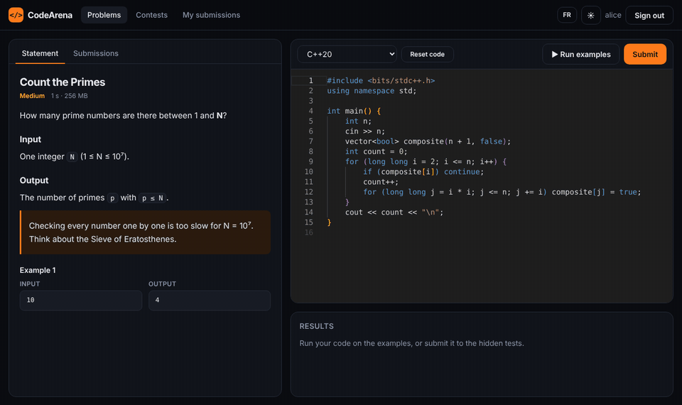

</div>

## Table of contents

- [What it does](#what-it-does)
- [Screenshots](#screenshots)
- [Architecture](#architecture)
- [How a submission is judged](#how-a-submission-is-judged)
- [The sandbox](#the-sandbox)
- [Tech stack](#tech-stack)
- [Getting started](#getting-started)
- [Configuration](#configuration)
- [API](#api)
- [Tests](#tests)
- [Project structure](#project-structure)
- [Roadmap](#roadmap)

## What it does

- 🧑‍💻 **Solve problems** in **C++20, Java 25, Python 3 or JavaScript** in a Monaco editor (the editor of VS Code). Drafts are saved per problem and language.
- ▶️ **Run** your code on the examples to see its output next to the expected one, then **Submit** it to the hidden tests.
- ⚡ **Live verdicts**: each test result is pushed over WebSocket as soon as it is judged — *Accepted*, *Wrong Answer*, *Time / Memory / Output Limit Exceeded*, *Runtime Error*, *Compilation Error*.
- 🏆 **Contests** with a countdown, a problem set that stays secret until the start, and a **live ICPC scoreboard** (problems solved, then penalty time, first solves highlighted).
- 🛠️ **Admin**: problem editor (Markdown statement, limits, sample and hidden test cases, drafts) and contest editor.
- 🌍 English / French, 🌗 dark / light theme, 📱 responsive, ♿ keyboard friendly.

## Screenshots

| Accepted, test by test | Too slow: Time Limit Exceeded |
| :---: | :---: |
| 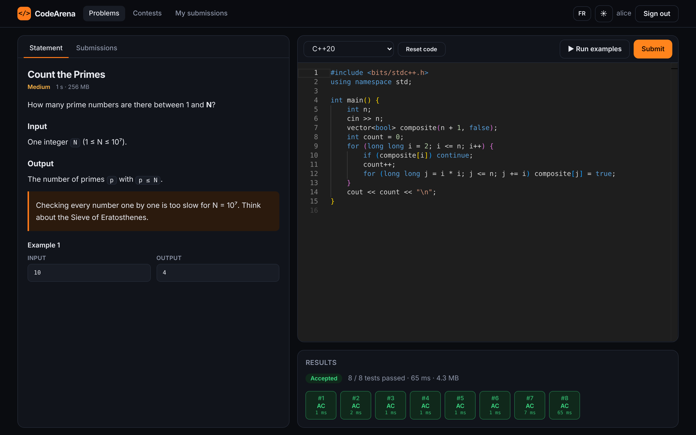 | 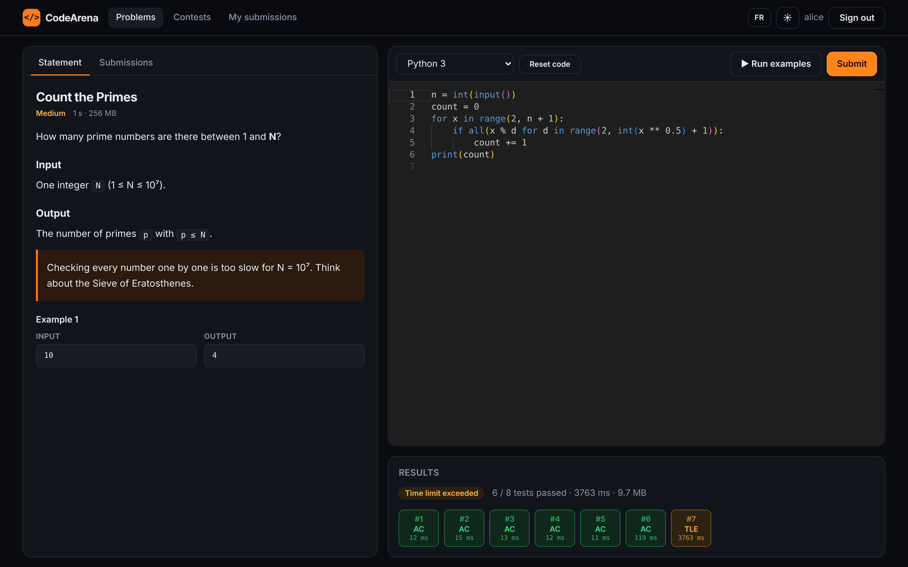 |
| **Run on the examples: your output vs expected** | **Live ICPC scoreboard** |
| 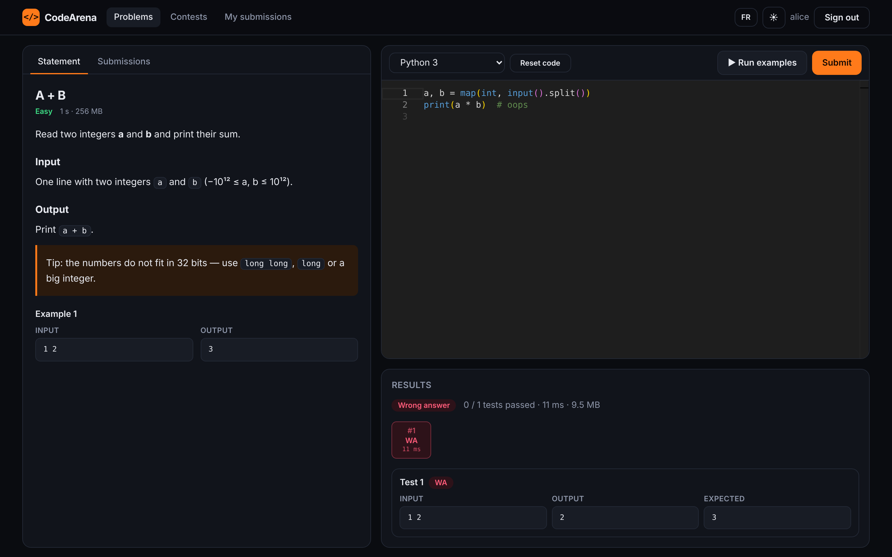 | 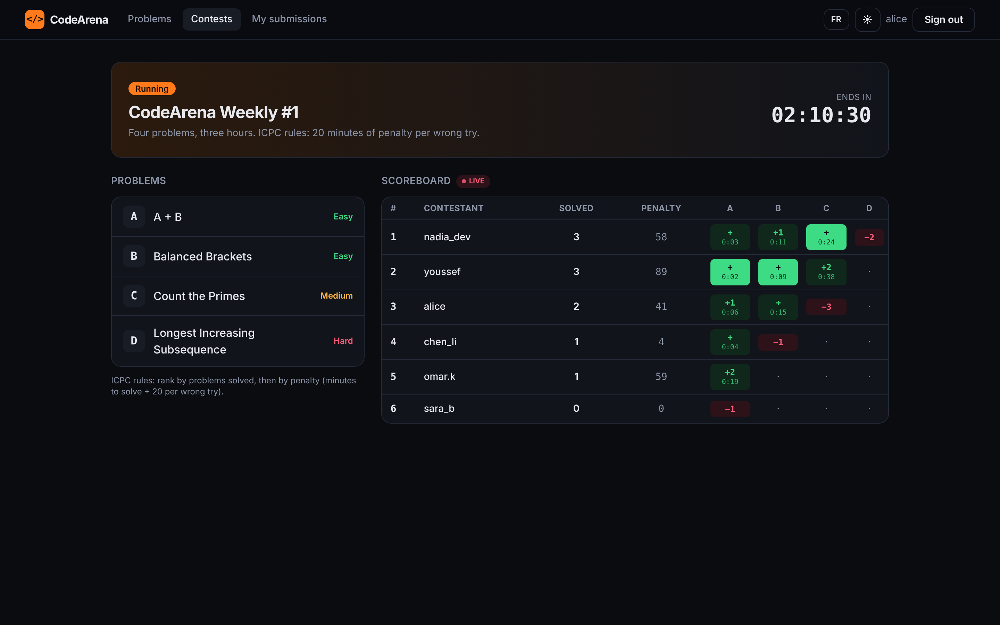 |
| **Problems** | **My submissions** |
| 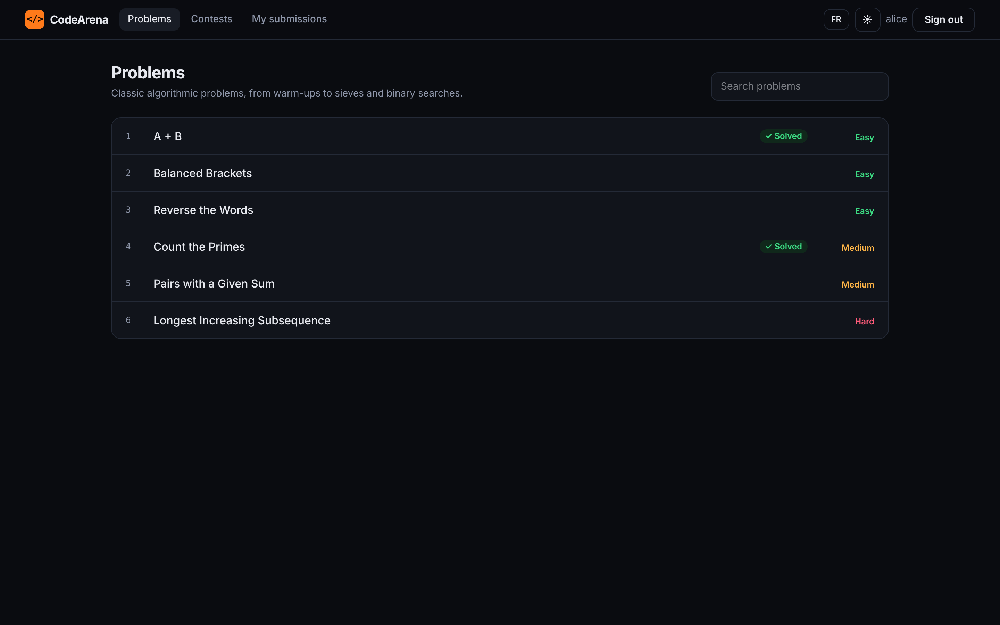 | 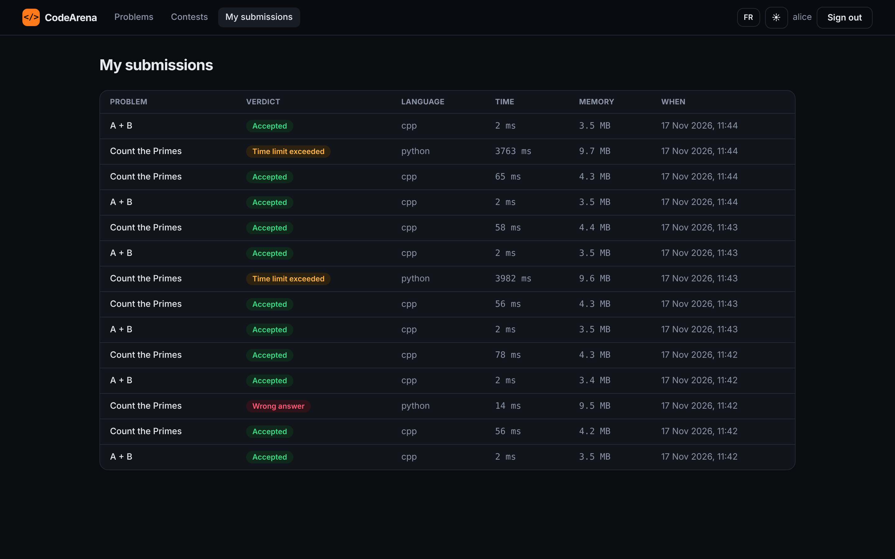 |
| **Admin: problem editor** | **Light theme, in French** |
| 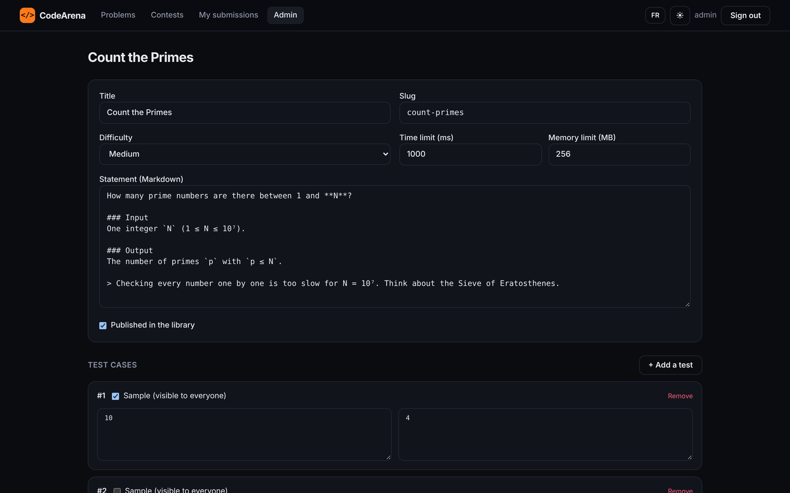 | 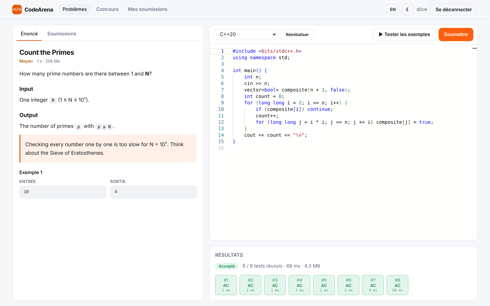 |

<p align="center">
  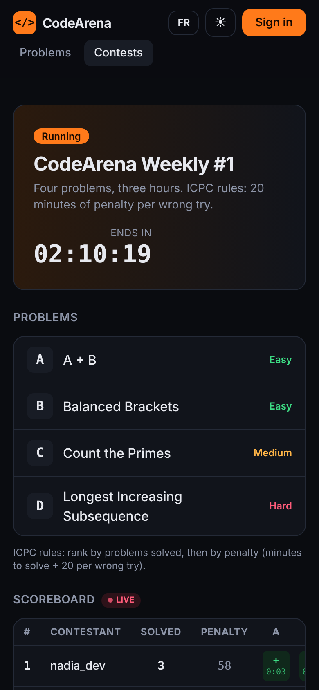
  &nbsp;
  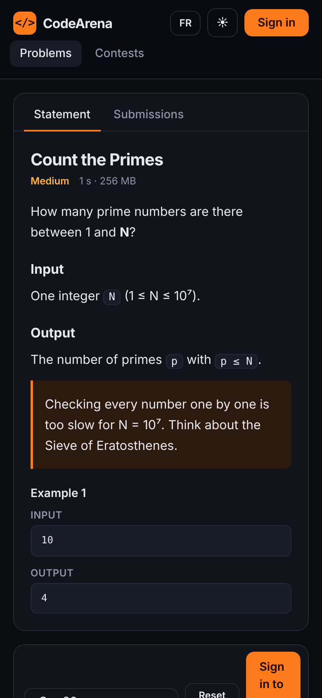
</p>

> Every verdict in these screenshots is real: the code was compiled and run by the Go judge in Docker sandboxes.

## Architecture

Three programs, each in the language that fits its job:

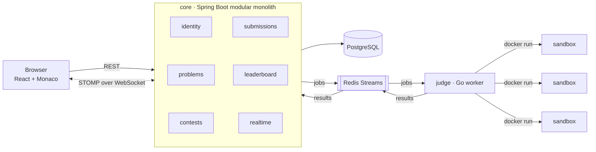

| Part | Language | Why |
| --- | --- | --- |
| **core** | Java 21 · Spring Boot 4 · **Spring Modulith** | Business rules, security, persistence, real time. One deployable, split into modules with enforced boundaries. |
| **judge** | **Go 1.26**, standard library only | Runs untrusted code: small static binaries, precise process control (process groups, rusage, signals), zero third-party dependencies in a security-critical component. |
| **web** | React 19 · TypeScript 7 · Vite | Monaco editor, live updates, i18n. |

### A modular monolith

The core is **one Spring Boot application split into six modules**. [Spring Modulith](https://spring.io/projects/spring-modulith) **fails the build** (`ModularityTests`) if a module touches another module's internals or if modules depend on each other in a cycle.

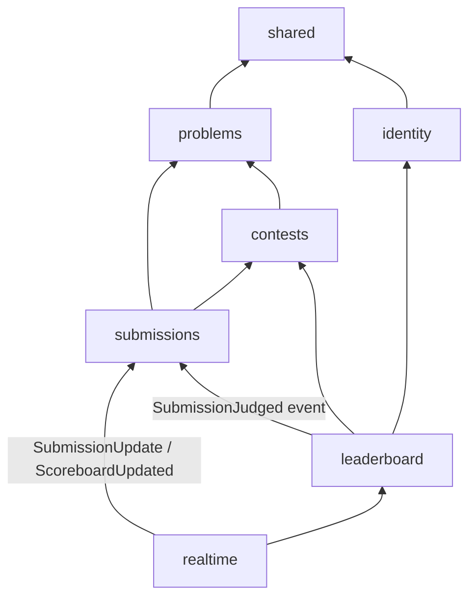

- Each module exposes a small **public API** (for example `ProblemCatalog`, `ContestDirectory`, `UserDirectory`); everything else lives in an `internal` package.
- Modules never share tables and refer to each other **by id only** — no cross-module foreign keys — so a module could later move to its own service.
- Modules talk through **events**. `SubmissionJudged` is stored in the **event publication registry** inside the same transaction as the verdict (a transactional outbox): if the leaderboard listener fails, the event is retried, never lost. Sending a job to Redis works the same way.
- The build also generates **C4 / UML diagrams** of the modules (`target/spring-modulith-docs`, uploaded by CI).

## How a submission is judged

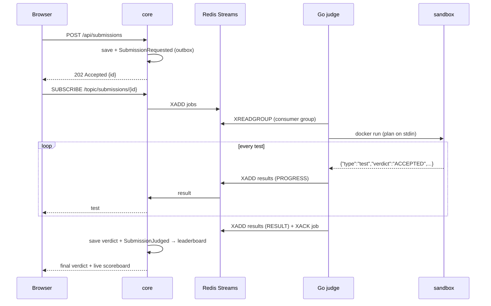

- **Reliable queue**: workers share the jobs through a **consumer group**; a job is acknowledged only after its results are published. If a worker crashes, another one **claims** its pending jobs (`XAUTOCLAIM`); a job that keeps failing is given up after 3 deliveries (poison message) and reported as *System Error*.
- **Scales out**: run more judge containers to judge more submissions in parallel (`JUDGE_CONCURRENCY` per worker).
- **Idempotent**: a result delivered twice is ignored.
- **RUN** uses the sample tests only and shows the output; **SUBMIT** runs every test and stops at the first failure, like Codeforces.

## The sandbox

Each submission runs in a **new, throwaway container**. Inside it, a tiny Go program, `boxrun`, compiles the code and runs every test.

| Threat | Protection |
| --- | --- |
| Reaching the network | `--network none` |
| Changing the system | `--read-only` root file system; only a 64 MB `tmpfs` is writable |
| Running as root | The program runs as **`nobody`** (uid 65534); `boxrun` keeps only `SETUID`, `SETGID` and `KILL`; `--cap-drop ALL`, `no-new-privileges` |
| **Reading the expected answers** | Hidden outputs never touch the disk: they reach `boxrun` on stdin and stay in its memory (another user's process) |
| Fork bomb | `--pids-limit 128`, then `boxrun` (PID 1) kills **every** process in the container until none is left |
| Eating memory | cgroup memory limit + per-test RSS check, or the runtime's own heap limit (JVM `-Xmx`, V8 `--max-old-space-size`) |
| Infinite loop / sleeping | CPU-time limit and a wall-clock kill (whole process group) |
| Printing forever | Output capped and the program killed → *Output Limit Exceeded* |
| Huge files, core dumps, too many files | `ulimit` on file size, core size and open files |
| Escaping the container | Optional **gVisor** runtime: `JUDGE_DOCKER_RUNTIME=runsc` |

Slower runtimes get a fair time limit: ×2 for Java, ×3 for Python, ×1.5 for JavaScript.

These protections are **tested against real containers in CI** (`TestRealSandbox`): no network access, a read-only root, not root, a contained fork bomb, a memory limit hit.

> ⚠️ The judge worker controls the Docker engine (`/var/run/docker.sock`). In production, run judges on dedicated machines, ideally with gVisor.

## Tech stack

| Area | Technologies |
| --- | --- |
| Core | Java 21, Spring Boot 4.1, **Spring Modulith 2.1** (module verification, event publication registry, docs), Spring Security (JWT, method security), Spring Data JPA, Flyway, Spring WebSocket (STOMP), Spring Data Redis, Bean Validation, Actuator |
| Judge | Go 1.26 (standard library only: own RESP client for Redis Streams), Docker |
| Web | React 19, TypeScript 7, Vite 8, Tailwind CSS 4, TanStack Query, React Router, Monaco Editor (bundled, no CDN), STOMP.js, react-markdown |
| Data | PostgreSQL 18, Redis 8 (Streams, consumer groups) |
| Quality | JUnit 5, MockMvc, Awaitility · Go tests with real compilers, Redis and Docker · Vitest, Testing Library · Prettier, oxlint, gofmt · GitHub Actions |
| Delivery | Docker Compose, multi-stage images, nginx |

## Getting started

### With Docker (recommended)

Requirements: **Docker Desktop** (Windows/macOS, with WSL 2 on Windows) or Docker Engine on Linux.

```bash
git clone https://github.com/Zakariae4AL/CodeArena.git
cd CodeArena
docker compose --profile runners build   # sandbox images, once (a few minutes)
docker compose up --build
```

Open **<http://localhost:8088>** and sign in with a demo account:

| Account | Username | Password |
| --- | --- | --- |
| Administrator | `admin` | `codearena1` |
| Contestant | `alice` | `codearena1` |

The demo comes with six problems (from *A + B* to *Longest Increasing Subsequence*, with generated big tests so slow solutions get *TLE*) and three contests: one running, one upcoming, one finished.

### For development

Run Postgres, Redis and the judge with Docker, and the core and the web app on your machine:

```bash
docker compose --profile runners build
docker compose up postgres redis judge -d
# Expose them: add  ports: ["5432:5432"] to postgres and ["6379:6379"] to redis, or use your own.

cd core && ./mvnw spring-boot:run          # http://localhost:8080   (Windows: mvnw.cmd)
cd web  && npm install && npm run dev      # http://localhost:5173   (proxies /api and /ws)
```

## Configuration

| Variable | Default | Used by | Description |
| --- | --- | --- | --- |
| `DB_URL` / `DB_USERNAME` / `DB_PASSWORD` | local `codearena` | core | PostgreSQL connection |
| `REDIS_HOST` / `REDIS_PORT` / `REDIS_PASSWORD` | `localhost:6379` | core | Redis |
| `JWT_SECRET` | dev value | core | HMAC key, **≥ 32 bytes**; refused in the `prod` profile if left to the dev value |
| `CORS_ORIGINS` | `http://localhost:5173` | core | Allowed web origins (HTTP and WebSocket) |
| `SUBMISSIONS_PER_MINUTE` | `10` | core | Per-user rate limit |
| `AUTH_RATE_LIMIT` | `10` | core | Login/register attempts per minute and IP |
| `SEED_DEMO` | `true` (`false` in `prod`) | core | Demo accounts, problems and contests |
| `REDIS_ADDR` / `REDIS_PASSWORD` / `REDIS_TLS` | `localhost:6379` | judge | Redis |
| `JUDGE_CONCURRENCY` | `2` | judge | Submissions judged in parallel per worker |
| `JUDGE_DOCKER_RUNTIME` | – | judge | e.g. `runsc` for gVisor |
| `JUDGE_IMAGE_PREFIX` | `codearena/runner-` | judge | Sandbox image names |
| `JUDGE_CPUS` / `JUDGE_PIDS_LIMIT` | `1` / `128` | judge | Sandbox limits |

## API

REST under `/api`, errors as [RFC 9457 problem details](https://www.rfc-editor.org/rfc/rfc9457), JWT in `Authorization: Bearer …`.

| Method | Endpoint | Access | Description |
| --- | --- | --- | --- |
| `POST` | `/auth/register`, `/auth/login` | Public | Returns a token (accounts are always `USER`) |
| `GET` | `/auth/me` | Signed in | Current user |
| `GET` | `/problems`, `/problems/{slug}` | Public | Published problems; statements show **sample** tests only |
| `GET` | `/languages` | Public | Supported languages |
| `POST` | `/submissions` | Signed in | `{problemId, contestSlug?, language, source, mode: RUN\|SUBMIT}` → `202` |
| `GET` | `/submissions/{id}`, `/submissions/mine`, `/submissions/solved` | Owner | Verdicts, per-test results, code |
| `GET` | `/contests`, `/contests/{slug}` | Public | Problems hidden until the start |
| `GET` | `/contests/{slug}/problems/{label}` | Public once started | Contest problem statement |
| `GET` | `/contests/{slug}/scoreboard` | Public | ICPC scoreboard |
| `GET/POST/PUT` | `/admin/problems/**`, `/admin/contests/**` | Admin | Editors (hidden tests included) |

**WebSocket** (`/ws`, STOMP): subscribe to `/topic/submissions/{id}` (live judging) and `/topic/contests/{id}/scoreboard`. Clients can **only subscribe** to these two kinds of topics: any `SEND` frame is rejected, so nobody can push a fake verdict to other users. Submission ids are random UUIDs and updates never contain source code.

## Tests

| Component | Tests | What they cover |
| --- | --- | --- |
| **judge** (Go) | 22 test functions, ~45 cases | Every verdict with **real** g++, javac, python3 and node; privilege drop; comparator; the RESP client and consumer group against a **real Redis** (including crash recovery); worker logic; **real Docker sandbox escape tests** |
| **core** (Java) | 29 | Module boundaries (Spring Modulith), auth and JWT attacks (forged, expired, `alg:none`), rate limits, hidden tests never exposed, drafts, contest secrecy, the full submission life cycle with a simulated judge, idempotent results, ICPC scoring, WebSocket topic protection, and a Redis round trip |
| **web** (React) | 17 | Login, problem list, the editor flow with live WebSocket updates, sample output display, live scoreboard, admin guard and problem editor, API client, i18n completeness |

```bash
cd judge && REDIS_ADDR=localhost:6379 go test ./...      # + JUDGE_DOCKER_IT=1 for the sandbox tests
cd core  && ./mvnw verify
cd web   && npm test
```

## Project structure

```
.
├── core/                       Spring Boot modular monolith
│   └── src/main/java/dev/codearena/
│       ├── shared/             errors, clock, current user, languages
│       ├── identity/           accounts, JWT, security rules
│       ├── problems/           statements, limits, test cases
│       ├── contests/           contest windows, problem sets
│       ├── submissions/        submissions, outbox, Redis Streams bridge
│       ├── leaderboard/        ICPC scoreboard projection
│       └── realtime/           STOMP WebSocket relay
├── judge/                      Go judge worker
│   ├── cmd/judge/              worker: Redis consumer group → sandbox
│   ├── cmd/boxrun/             runs inside each sandbox (PID 1)
│   └── internal/               protocol, boxrun, sandbox, queue, worker
├── web/                        React + Vite app
├── docs/                       screenshots and GIF
├── docker-compose.yml
└── .github/workflows/ci.yml
```

## Roadmap

- Scoreboard freeze during the last hour, and virtual participation in past contests
- Special checkers (floating-point tolerance, several valid answers)
- Interactive problems
- Prometheus metrics for queue length and judging time
- More languages (Go, Rust, Kotlin) — one entry in the language table plus one Docker image

---

Made by **Zakariae** — [@Zakariae4AL](https://github.com/Zakariae4AL). Released under the [MIT License](LICENSE).
